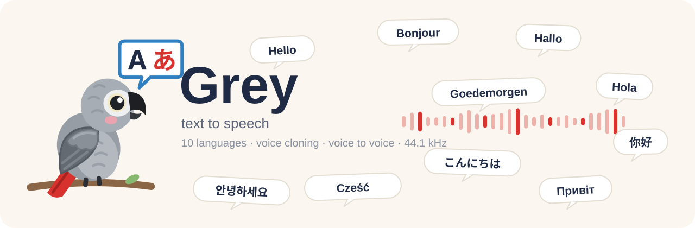
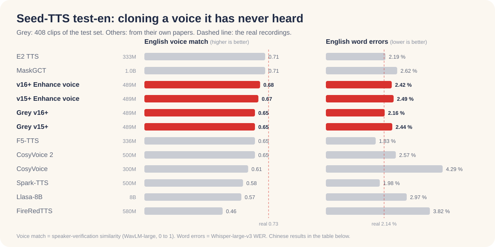
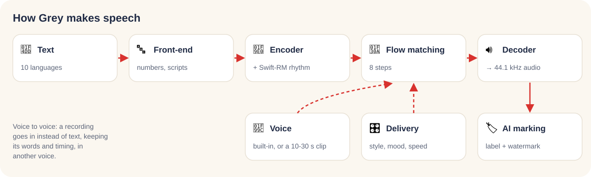

<p align="center">
  
</p>

<p align="center">
  <a href="https://randy-h0.github.io/Grey-tts/"></a>
  <a href="https://thisvoiceisai.com"></a>
  <a href="https://thisvoiceisai.com/download/"></a>
</p>

<p align="center">
  
  
  
  
  
  <a href="LICENSE"></a>
  
</p>

**Grey** is a text-to-speech model named after the African grey parrot 🦜: the bird that talks back in your own voice.
It speaks **ten languages**, **clones a voice** from a short recording, does **voice to voice**, and lets you steer
*how* it talks: whispering, acting, fast, slow, timing and emphasis. It makes speech as continuous latents with flow
matching, decoded at 44.1 kHz by the KVAE-Audio codec.

This repository is the model, inference, training and a command line. Don't want to code? Use the
[website](https://thisvoiceisai.com) or the offline [Grey Studio](https://thisvoiceisai.com/download/) app for Windows.

## 🎧 Listen

All samples come from **Grey v16+** with its made-up voices Jonas, Lena and Daan (no real people), made on a CPU.
First takes, except Spanish and Chinese: those had a word slip, so they're the next take that read every word right.
▶️ **[Open the samples page](https://randy-h0.github.io/Grey-tts/)** to play them in your browser, or click a file below.

| | Language | Grey says… | |
|---|---|---|---|
| 🇬🇧 | English | *Hi, I'm Grey! I'm named after a parrot that never stops talking, so, fair warning.* | [▶️ en.mp3](docs/samples/en.mp3) |
| 🇩🇪 | German | *Guten Morgen! Der Kaffee ist fertig, und ich habe heute erstaunlich gute Laune.* | [▶️ de.mp3](docs/samples/de.mp3) |
| 🇳🇱 | Dutch | *Het regent alweer in Amsterdam, maar eerlijk gezegd vind ik dat best gezellig.* | [▶️ nl.mp3](docs/samples/nl.mp3) |
| 🇫🇷 | French | *Bonjour ! Je peux lire ce texte avec plaisir, même si la phrase est un peu longue.* | [▶️ fr.mp3](docs/samples/fr.mp3) |
| 🇪🇸 | Spanish | *¡Hola! Hoy hace un día precioso para salir a pasear por la playa.* | [▶️ es.mp3](docs/samples/es.mp3) |
| 🇵🇱 | Polish | *Dzień dobry! Chciałbym zamówić dużą pizzę z podwójnym serem, poproszę.* | [▶️ pl.mp3](docs/samples/pl.mp3) |
| 🇺🇦 | Ukrainian | *Привіт! Сьогодні чудовий день, щоб вивчити щось нове.* | [▶️ uk.mp3](docs/samples/uk.mp3) |
| 🇯🇵 | Japanese | *こんにちは！今日はとてもいい天気ですね。散歩に行きませんか？* | [▶️ ja.mp3](docs/samples/ja.mp3) |
| 🇨🇳 | Chinese | *你好！我是一个会说十种语言的语音模型，很高兴认识你。* | [▶️ zh.mp3](docs/samples/zh.mp3) |
| 🇰🇷 | Korean | *안녕하세요! 오늘 저녁에 같이 맛있는 거 먹으러 갈래요?* | [▶️ ko.mp3](docs/samples/ko.mp3) |
| 🤫 | Whisper | *Shh. Don't tell anyone, but I can whisper too.* | [▶️ en_whisper.mp3](docs/samples/en_whisper.mp3) |
| ⚡ | Fast | *And when I'm in a hurry, I can talk really, really fast without tripping over my words.* | [▶️ en_fast.mp3](docs/samples/en_fast.mp3) |
| 🐢 | Slow | *Or I can take my time... and say every word... slowly.* | [▶️ en_slow.mp3](docs/samples/en_slow.mp3) |
| 🎭 | Acting | *No way! You actually did it? That's the best news I've heard all week!* | [▶️ en_acting.mp3](docs/samples/en_acting.mp3) |

## ✨ What it can do

- 🌍 **10 languages**: English, German, Dutch, French, Spanish, Polish, Ukrainian, Japanese, Chinese, Korean.
- 🎙️ **Voice cloning**: 10-30 seconds of someone (with their permission) is enough.
- 🔁 **Voice to voice**: record yourself, hear the same words and timing in another voice.
- 🎛️ **Delivery controls**: narration ↔ acting, mood, assertiveness, whisper ↔ shout, speed, timing, emphasis.
- 🗣️ **Accent fix**: a voice speaking another language takes on that language's accent.
- 🪶 **Small models too**: Smol runs on a laptop CPU (and in a web browser).
- 🏷️ **Honest output**: every file is labelled as AI-generated and watermarked (EU AI Act, art. 50).

## 📊 Benchmark

The standard voice-cloning test ([Seed-TTS eval](https://github.com/BytedanceSpeech/seed-tts-eval)): clone a voice the
model has never heard from a short clip, read new text, then count word errors and score how alike the voices are.

<p align="center"></p>

| Model | Size | EN word errors ↓ | EN voice match ↑ | ZH word errors ↓ | ZH voice match ↑ |
|---|---|---|---|---|---|
| **Grey v15+** | 489M | 2.44 % | 0.65 | **0.81 %** | 0.74 |
| **Grey v15+ · Enhance voice** | 489M | 2.49 % | 0.67 | 1.47 % | 0.76 |
| F5-TTS | 336M | **1.83 %** | 0.65 | 1.56 % | 0.74 |
| E2 TTS | 333M | 2.19 % | **0.71** | 1.97 % | 0.73 |
| CosyVoice 2 | 500M | 2.57 % | 0.65 | 1.45 % | 0.75 |
| MaskGCT | 1.0B | 2.62 % | **0.71** | 2.27 % | **0.77** |
| Spark-TTS | 500M | 1.98 % | 0.58 | 1.20 % | 0.67 |
| Llasa-8B | 8B | 2.97 % | 0.57 | 1.59 % | 0.68 |
| FireRedTTS | 580M | 3.82 % | 0.46 | 1.51 % | 0.64 |
| CosyVoice | 300M | 4.29 % | 0.61 | 3.63 % | 0.72 |
| *Real recordings* | | *2.14 %* | *0.73* | *1.25 %* | *0.75* |

Grey measured on the **full** test sets (test-en, test-zh) with the official scorers; the other numbers come from each
model's own paper on the same sets. v16+ hasn't been through the full benchmark yet. "Enhance voice" is a second pass
that re-clones from the first take (in Grey Studio and on the website).

## 🚀 Quick start

Python 3.12 and an NVIDIA GPU are recommended (a CPU works too, just slower).

```bash
git clone https://github.com/Randy-H0/Grey-tts.git && cd Grey-tts
pip install torch torchaudio --index-url https://download.pytorch.org/whl/cu128
pip install -r requirements.txt
pip install -e third_party/kvae-audio
python grey.py download v16plus
python grey.py speak "Hello! This is Grey." -o hello.wav
```

🎉 That's it: `hello.wav` is Grey talking. More things to try:

```bash
python grey.py download --list                                   # every model and what it can do
python grey.py voices                                            # the built-in voices of a model
python grey.py speak "Guten Tag!" --voice lib_lena -o hallo.wav  # a built-in voice
python grey.py speak "Hi, it's me." --ref me.wav -o me.wav       # your own voice from a 10-30 s recording
python grey.py vtv input.wav --voice lib_daan -o out.wav         # voice to voice (v14.5 and newer)
python grey.py speak "Shh..." --voice lib_lena --speed 0.2 -o s.wav --seed 7
```

### 🐍 In Python

```python
from dacts.infer import Synthesizer
from dacts.marking import write_ai_wav

grey = Synthesizer.from_checkpoint("models/v16plus.pt", device="cuda")
wav = grey("Hello there.", speaker="expresso_ex01", lang="en", steps=8, guidance=3.0)[0]   # 44.1 kHz float32
write_ai_wav("hello.wav", wav, 44100)

# whisper, acting, speed: volume 0 (whisper) .. 1 (shout), style 0 (narration) .. 1 (acting), speed 0 .. 1
wav = grey("Don't tell anyone.", speaker="expresso_ex01", lang="en", volume=0.05)[0]
```

## 🧩 How it works

<p align="center"></p>

## 🗂️ Models

| Model | Languages | Own voices | Voice to voice |
|---|---|---|---|
| **v16+** ⭐ | 10 (+ 🇺🇦 Ukrainian) | ✅ | ✅ |
| v15+ / v15 | 9 | ✅ | ✅ |
| v14.5 | 7 | ✅ | ✅ |
| v13 XL | 7 | ✅ | — |
| v14.5 Smol / v13 Smol | 7 | — | — |
| v12 | 6 | — | — |
| v10 / v6 | 3 | — | — |

`python grey.py download <id>` fetches a model (resumable, checked by SHA-256). What changed in each version:
[CHANGELOG.md](CHANGELOG.md).

## 🏋️ Training on your own data

```bash
python preprocess.py --help          # audio -> clips, per speaker
python transcribe.py --help          # text for each clip
python encode_kvae.py --help         # clips -> codec latents
python add_labels.py --help          # style / speed / loudness labels;  label_clean_gpu.py: quality labels
python train.py --data data/my_set --out runs/my_run --init models/v16plus.pt lora_rank=16
```

`train.py` takes any setting of `dacts/config.py` as `key=value` (`--resume` continues a run in `--out`). A LoRA
fine-tune of a few speakers (`lora_rank=16`, `grad_ckpt=True`) fits a 6-8 GB GPU.

<details>
<summary>📁 <b>What's where</b></summary>

```
dacts/            the model package
  infer.py          Synthesizer: text to speech, cloning (add_voice / make_prompt), voice to voice (convert)
  model.py          the model (text encoder, duration / rhythm model, flow-matching decoder, voice conditioning)
  text.py           text front-end for the ten languages (numbers, stress, scripts); numerals.py
  codec.py          KVAE-Audio latents <-> audio; fast_codec.py, fast_encoder.py (distilled students)
  data.py, fastdata.py   training data loading
  marking.py        AI label + watermark for every output
  ...               labels (style, emotion, delivery), voice embeddings, LoRA, voice to voice (vtv.py), ...
train.py          training (and fine-tuning / LoRA: lora_rank=..., only_speakers=...)
preprocess.py     data preparation: audio -> clips; transcribe.py, encode_kvae.py, add_labels.py,
                  label_clean_gpu.py, relabel_band.py, extract_spkemb.py, fix_whisper_labels.py
grow.py, grow_v13xl.py   growing a model's voice table / languages for new data
configs/          small data files the front-end and labels read
tools/            export_voicelang.py (the language-fix table for a model)
third_party/      kvae-audio (MIT), rmvpe pitch tracker (MIT), DNSMOS quality model (CC BY 4.0)
docs/             the samples page (GitHub Pages)
grey.py           command line;  download_model.py   model downloads
```
</details>

## ❓ FAQ

<details><summary><b>Do I need a GPU?</b></summary>

No, but it helps a lot. An NVIDIA GPU with 6 GB or more is plenty; on a CPU, try the Smol models
(`python grey.py download smol`).
</details>

<details><summary><b>Can I use it commercially?</b></summary>

No. Grey is free for personal, non-commercial use. Part of its training data (Emilia, CC BY-NC 4.0) and some voices
only allow non-commercial use.
</details>

<details><summary><b>Why is my output watermarked?</b></summary>

Every file Grey makes says it's AI-generated: a label in the WAV file and an inaudible
[AudioSeal](https://github.com/facebookresearch/audioseal) watermark. The EU AI Act (art. 50) asks this of systems that
make synthetic audio, and it keeps cloned voices from passing as real recordings. Please keep the marks in.
</details>

<details><summary><b>Whose voice can I clone?</b></summary>

Your own, or someone who said yes. Never use Grey to impersonate, deceive or defraud anyone.
</details>

<details><summary><b>Can I add a language?</b></summary>

Yes: a front-end in `dacts/text.py`, some transcribed speech, and a fine-tune from v16+ (grow the language table with
`grow.py`). Open an issue first and we'll help.
</details>

## 🤝 Contributing

Ideas, bug reports and pull requests are welcome: see [CONTRIBUTING.md](CONTRIBUTING.md) and the
[code of conduct](CODE_OF_CONDUCT.md). Security problems: [SECURITY.md](SECURITY.md).

## 📚 Citation

```bibtex
@software{grey_tts,
  title  = {Grey: multilingual text to speech with voice cloning and voice to voice},
  author = {{Grey TTS contributors}},
  year   = {2026},
  url    = {https://github.com/Randy-H0/Grey-tts}
}
```

## 🙏 Thanks

[KVAE-Audio](third_party/kvae-audio) (the codec), [RMVPE](third_party/rmvpe) (pitch),
[DNSMOS](third_party/dnsmos) (quality labels), [AudioSeal](https://github.com/facebookresearch/audioseal) (watermark),
[Seed-TTS eval](https://github.com/BytedanceSpeech/seed-tts-eval) (benchmark), and every open speech dataset and
voice Grey learned from: [credits](https://thisvoiceisai.com/terms.html#credits).

## 📄 Licence

Free for personal, non-commercial use: see [LICENSE](LICENSE). Third-party code keeps its own licence
(`third_party/*/LICENSE`). Only clone voices that are yours or that you have permission for.

<p align="center">Made in the Netherlands 🇳🇱 · <a href="mailto:support@thisvoiceisai.com">support@thisvoiceisai.com</a></p>
